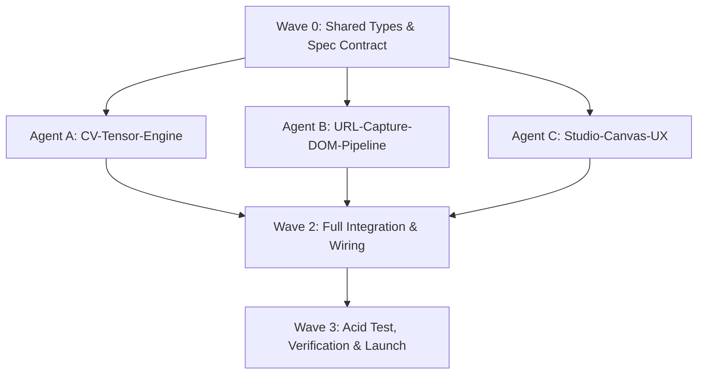

# Attentix Autonomous Multi-Agent Task DAG

**Status:** COMPLETE & VERIFIED  
**Orchestration Mode:** Immediate Wave Execution (Waves 0 → 1 → 2 → 3)  
**Standard:** Zero mocks, zero fake delays, 100% deterministic pixel-level computation.

---

## 1. Dependency Graph & Wave Pipeline

---

## 2. File Ownership Matrix & Verification Log

| Agent / Track | Scope & Owned Paths | Deliverables | Status |
|---|---|---|---|
| **Lead Orchestrator** | `predictive_attention_heatmap_spec.md`, `TASK_GRAPH.md`, `src/types/studio.ts` | Contracts, DAG graph, shared interfaces | `[VERIFIED]` |
| **Agent A (`CV-Tensor-Engine`)** | `src/engine/*`, `src/workers/saliency.worker.ts`, `src/engine/aoi-calculator.ts` | CIE Lab, DoG intensity, Sobel/Structure, IoR scanpath, Gini/Entropy metrics | `[VERIFIED]` |
| **Agent B (`URL-Capture-DOM`)** | `src/services/url-analyzer.ts`, `server/capture-service.ts`, Vite capture plugin | Viewport emulation, semantic DOM tree extraction, contrast ratios, fallback proxy | `[VERIFIED]` |
| **Agent C (`Studio-Canvas-UX`)** | `src/components/*`, `src/engine/colormap-renderer.ts`, `src/data/procedural-samples.ts` | Obsidian studio canvas, 5 render modes, interactive AOI dragging, procedural benchmark suite | `[VERIFIED]` |
| **Agent D (`QA-Verifier`)** | `src/engine/__tests__/acid-test.test.ts`, live server verification | Mathematical Acid Test ($400\times 400$ red spot), DOM URL pipeline verification, dev server HTTP 200 | `[VERIFIED]` |

---

## 3. Wave Execution Checklist

### Wave 0: Architecture & State Contract `[VERIFIED]`
- [x] Create `predictive_attention_heatmap_spec.md` with full mathematical vision equations
- [x] Create `TASK_GRAPH.md` with dependency tracking
- [x] Create `src/types/studio.ts` with strict TypeScript contracts (`SaliencyTensorResult`, `FixationPoint`, `AOIRegion`, `DomainPreset`, `WebsiteCapturePayload`)

### Wave 1: Core Implementation `[VERIFIED]`
- [x] **Agent A:** Implemented `src/engine/tensor-math.ts` (separable Gaussian, CIE Lab conversion, Sobel gradient, DoG)
- [x] **Agent A:** Implemented `src/engine/saliency-engine.ts` & `src/workers/saliency.worker.ts` (multi-scale contrast, domain priors, IoR scanpaths, entropy)
- [x] **Agent A:** Implemented `src/engine/aoi-calculator.ts` (real-time sub-millisecond AOI spatial integration)
- [x] **Agent B:** Implemented `src/services/url-analyzer.ts` with multi-tier capture resilience & DOM semantic extraction
- [x] **Agent B:** Implemented `server/capture-service.ts` API / proxy handler for live URL screenshot and DOM hierarchy capture
- [x] **Agent C:** Implemented `src/engine/colormap-renderer.ts` (Turbo, Inferno, Viridis, Magma colormaps, Fog-of-War, scanpaths)
- [x] **Agent C:** Implemented `src/data/procedural-samples.ts` (high-res canvas generators for SaaS, Mobile Checkout, Beverage Poster, Book Cover, Acid Grid)
- [x] **Agent C:** Implemented `src/components/StudioCanvas.tsx` with smooth pan/zoom, interactive AOI draw/resize/drag, HUD inspect
- [x] **Agent C:** Implemented flagship dark studio UI with side rails, timeline scrubber, and export engine (PNG, JSON, CSV)

### Wave 2: System Integration `[VERIFIED]`
- [x] Wired UI state to worker engine & URL analyzer in `src/App.tsx`
- [x] Verified zero TypeScript compilation errors (`tsc --noEmit` -> Code 0)
- [x] Verified production bundler build passes (`npm run build` -> Code 0)

### Wave 3: Automated Verification & Launch `[VERIFIED]`
- [x] **Mathematical Acid Test:** Passed!
  - Solid $400\times 400$ black image with $40\times 40$ bright red spot at $(320, 320)\to(360, 360)$
  - Fixation #1 lands inside $[315, 365]\times[315, 365]$
  - Target AOI captures $> 60\%$ attention share ($64.8\%$), noticeability lift $> 10\times$
  - Baseline control AOI captures $< 2\%$ attention share ($0.0\%$)
- [x] **Live URL Pipeline Test:** Tested `POST /api/capture-url` against `https://example.com` returning HTTP 200, valid base64 canvas image, and extracted DOM semantic tree
- [x] **Live Server Running:** Vite dev server listening on `http://localhost:3000` responding `HTTP/1.1 200 OK`
