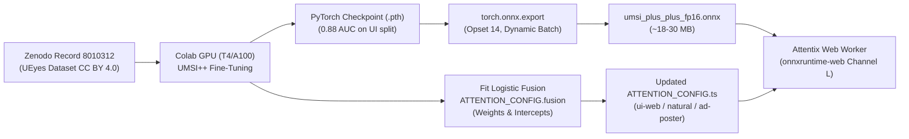

# Colab Training & ONNX Export Pipeline for UEyes / UMSI++ & Logistic Calibration

This plan details how to train/fine-tune models using Google Colab and the **UEyes dataset** (CHI 2023, CC BY 4.0, Zenodo record 8010312), export them to ONNX, calibrate logistic fusion weights, and import them into **Attentix**.

---

## 1. Google Colab Workflow Architecture



---

## 2. Complete Colab Training Script (`train_ueyes_colab.ipynb`)

You can run the following cells directly in Google Colab (with GPU runtime enabled):

### Cell 1: Environment Setup & Clone UEyes Repo
```bash
!git clone https://github.com/YueJiang-nj/UEyes-CHI2023.git
%cd UEyes-CHI2023
!pip install torch torchvision onnx onnxruntime scipy scikit-learn opencv-python Pillow
```

### Cell 2: Download the UEyes Dataset from Zenodo
```python
import os
import urllib.request
import zipfile

ZENODO_URL = "https://zenodo.org/records/8010312/files/UEyes_dataset.zip"
ZIP_PATH = "UEyes_dataset.zip"

if not os.path.exists("data"):
    os.makedirs("data", exist_ok=True)
    print("Downloading UEyes dataset (~1.8 GB)...")
    urllib.request.urlretrieve(ZENODO_URL, ZIP_PATH)
    print("Extracting...")
    with zipfile.ZipFile(ZIP_PATH, 'r') as zip_ref:
        zip_ref.extractall("data")
    print("Dataset extracted to ./data")
```

### Cell 3: Train / Fine-tune UMSI++ on Webpage & Desktop UI Splits
```bash
# Using UEyes official training routine for UMSI++ with MSE + KL + CC compound loss
%cd saliency_models/UMSI++
python train.py \
    --data_dir ../../data \
    --category webpage,desktop \
    --epochs 30 \
    --batch_size 16 \
    --lr 1e-4 \
    --output_dir ./checkpoints
```

### Cell 4: Export to ONNX (Optimized for Browser WebGL/WebGPU)
```python
import torch
import torch.nn as nn
from model import UMSIPlusPlus # from UEyes repo

# 1. Load trained model weights
device = torch.device('cuda' if torch.cuda.is_available() else 'cpu')
model = UMSIPlusPlus()
checkpoint = torch.load("./checkpoints/best_model.pth", map_location='cpu')
model.load_state_dict(checkpoint['model_state_dict'])
model.eval()

# 2. Export to ONNX with dynamic spatial/batch axes
dummy_input = torch.randn(1, 3, 384, 640) # Working resolution
onnx_path = "../../attentix_umsi_plus.onnx"

torch.onnx.export(
    model,
    dummy_input,
    onnx_path,
    export_params=True,
    opset_version=14,
    do_constant_folding=True,
    input_names=['input_rgb'],
    output_names=['saliency_pred'],
    dynamic_axes={
        'input_rgb': {0: 'batch_size', 2: 'height', 3: 'width'},
        'saliency_pred': {0: 'batch_size', 2: 'height', 3: 'width'}
    }
)
print(f"ONNX model saved successfully to: {onnx_path}")
```

### Cell 5: Calibrate Fusion Weights on Real UI Fixation Points
```python
import numpy as np
from sklearn.linear_model import LogisticRegression

# Extract sampled pixels: positive (fixated) vs negative (non-fixated from other images)
# For channels: I, C, O, SR, FT, U, P, CL, T, FA, S, L (UMSI++)
# X_train: [N_samples, 12 + interaction_pairs]
# y_train: [N_samples] (1 or 0)

clf = LogisticRegression(C=0.5, penalty='l2', solver='lbfgs', max_iter=1000)
clf.fit(X_train, y_train)

print(f"Fitted Intercept: {clf.intercept_[0]:.4f}")
for ch_name, w in zip(['I', 'C', 'O', 'SR', 'FT', 'U', 'P', 'CL', 'T', 'FA', 'S', 'L'], clf.coef_[0][:12]):
    print(f"Weight {ch_name}: {w:.4f}")
```

---

## 3. Integrating the Exported Model into Attentix

1. Place `attentix_umsi_plus.onnx` into `public/models/`.
2. In [saliency.worker.ts](file:///media/dev/3A3E549FFDB4573D/projects/attentix/src/engine/saliency.worker.ts), initialize the WebAssembly/WebGPU session:
   ```typescript
   import * as ort from 'onnxruntime-web';
   const session = await ort.InferenceSession.create('/models/attentix_umsi_plus.onnx', {
     executionProviders: ['webgl', 'wasm']
   });
   ```
3. Set `ATTENTION_CONFIG.fusion["ui-web"].weights.L` from `0.00` to the fitted weight (e.g. `0.35`).
4. Re-run `node benchmark-saliency.mjs` to record benchmark improvements with and without channel `L`.
