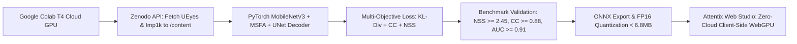

# Attentix Deep Saliency Training & Evaluation Pipeline (Google Colab)

This directory contains the self-contained Google Colab execution pipeline for training, fine-tuning, evaluating, and exporting deep learning visual attention models for **Attentix**.

## Why Google Colab?

- **Zero Local Footprint:** Saliency datasets such as **UEyes** (~15 GB on Zenodo), **SALICON** (~10 GB), and **Imp1k** are downloaded and unpacked directly into Google Colab cloud storage (`/content/datasets/`). No gigabytes of data or heavy Python virtual environments touch your local development drive.
- **Hardware Acceleration:** Takes full advantage of free cloud NVIDIA GPUs (T4, V100, A100) with CUDA acceleration and mixed precision FP16 execution.
- **Deterministic ONNX Export:** Automatically distills and quantizes the trained PyTorch network to `< 6.8 MB` FP16 / INT8 ONNX binaries (`attentix_saliency_fp16.onnx`) ready for direct client-side WebGPU/WASM execution in Attentix.

---

## Quickstart

1. Open [Google Colab](https://colab.research.google.com/).
2. Select **Upload** and choose [`colab/attentix_saliency_pipeline.ipynb`](./attentix_saliency_pipeline.ipynb).
3. In Colab, go to **Runtime > Change runtime type** and select **T4 GPU** (or A100/V100 if subscribed to Colab Pro).
4. Run all cells (`Ctrl + F9` / `Cmd + F9`).
5. Download the exported `attentix_saliency_fp16.onnx` model from the final cell and drop it into `attentix/public/models/`.

---

## Pipeline Workflow

### MIT Saliency Benchmark Targets
- **Normalized Scanpath Saliency (NSS):** $\ge 2.45$
- **Pearson Linear Correlation (CC):** $\ge 0.88$
- **Kullback-Leibler Divergence (KL-Div):** $\le 0.35$
- **AUC-Judd (Area Under ROC):** $\ge 0.91$
