# ATTENTIX — PRINCIPAL STATIC ANALYSIS & FORMAL VERIFICATION HANDOFF

**Repository:** `github.com/txorav/attentix`
**Analyzed:** `/tmp/kilo/attentix` (8 commits, 120 files, ~12k LOC)
**Analyzer:** Principal Static Analysis & Formal Verification Agent (Kilo)
**Date:** 2026-11-06
**Methodology:** 3-stage funnel (Skeleton → Centrality → k-hop Ego-graph) + 4 formal methods (Slicing, Symbolic Execution, Abstract Interpretation/Lattice, Hoare Logic)

> **NOTE:** The user referred to this as an "Android codebase." It is NOT Android. `txorav/attentix` is a **browser-based (TypeScript/React/Vite/WebGL2)** deterministic visual attention & saliency prediction studio. All analysis below treats it as a client-side numerical CV pipeline with an embedded local node capture proxy. No native/Android source exists in this repo.

---

## PART 1 — GRAPH TOPOLOGY & CENTRALITY MATRIX

### Heterogeneous Code Property Graph $G=(V,E)$
Relation types: `contains`, `imports`, `invokes`, `inherits`, `instantiates`, `persists`.

#### Afferent/Efferent Coupling Estimates (from import graph)

| Module / File | Role | $C_a$ (In-Degree) | $C_e$ (Out-Degree) | Instability $I=C_e/(C_a+C_e)$ | Core Symbols Defined |
|---|---|---:|---:|---:|---|
| `src/engine/saliency-core.mjs` | **Core Domain Hub** — 10-factor saliency engine, logistic fusion, AOI hysteresis, scanpath IoR, posterior sampling | 12+ | 3 | **~0.20** | `analyzeImageBuffer`, `generatePredictedScanpath`, `extractAOIsHysteresis`, `computeAOIMetrics`, `computeCognitiveLoadAndClarity`, `computeConcentrationMetrics`, `renderAttentionHeatmapRGBA`, `fft2D`, `convolveSeparable`, `srgbToLab` |
| `src/engine/convex-fit.mjs` | Convex ML fusion optimizer (weights + Hessian covariance) | 2 | 1 | **~0.33** | `fitConvexFusion`, `computeLossAndGradient`, `computeHessianAndCovariance`, `samplePosteriorAoiIntervals`, `checkGradient`, `checkConvexity` |
| `src/core/saliencyEngine.ts` | Core grid/layout/pixel preprocessing bridge | 4 | 2 | **~0.33** | `computeAnalysisGridDimensions` |
| `src/core/metricsCalculator.ts` | Cognitive load/clarity/entropy indices | 3 | 3 | **~0.50** | `computeQuantiles`, `computeNeuromarketingMetrics`, `generateScanpathFromRealCV` |
| `src/engine/aoi-calculator.ts` | Real-time AOI spatial integrator (<2ms) | 3 | 2 | **~0.40** | `calculateAOIMetrics`, `recalculateAllAOIs` |
| `src/engine/tensor-math.ts` | Primitive CV math (Lab, Gaussian, DoG, Sobel, skin chroma) | 2 | 0 | **~0.00** | `convertRGBToLabBuffers`, `gaussianBlur2D`, `differenceOfGaussians`, `computeSobelGradients`, `computeSkinChromaTensor`, `normalizeMinMaxInPlace` |
| `src/engine/saliency-engine.ts` | Top-level `runSaliencyAnalysis` orchestration | 2 | 5 | **~0.71** | `runSaliencyAnalysis`, `computeColorOpponencyTensor`, `computeRetinalIntensityTensor`, `generateIoRScanpath`, `generateDomainPrior`, `computeEntropyAndClarity` |
| `src/engine/saliency-client.ts` | Worker proxy w/ sync fallback + 25s timeout guard | 3 | 2 | **~0.40** | `executeSaliencyAnalysis` |
| `src/workers/saliency.worker.ts` | Off-main-thread ONNX inference + fused analysis | 1 | 6 | **~0.86** | `getTierHardwareProfile`, `runTierOnnxInference`, `getOrInitOnnxSession` |
| `src/services/url-analyzer.ts` | URL capture → DOM semantic elements → AOIs | 1 | 2 | **~0.67** | `captureWebsiteUrl`, `generateHighFidelityWebCapture`, `parseDomainProfile`, `convertDOMToAOIs` |
| `server/capture-service.ts` | Local node `/api/capture-url` HTTP proxy (fetch+DOM parse+SVG raster) | 0 | 1 | **~1.00** | `handleCaptureUrlRequest`, `handleProxyWebRequest`, `parseSemanticDOMElements` |
| `src/App.tsx` | Volatile orchestrator / entry point (React root) | 1 | 15 | **~0.94** | `App`, `triggerAnalysis`, `handleCaptureUrl`, `handleRepeatAnalysis` |
| `src/engine/colormap-renderer.ts` | WebGL2/Canvas colormap LUT + heatmap/fog renderer | 2 | 1 | **~0.33** | `renderCanvasVisualOverlay`, `getLUTColor`, `buildLUTBuffer` |
| `src/core/webglRenderer.ts` | WebGL2 heatmap renderer + Canvas 2D fallback | 1 | 1 | **~0.50** | `webglRenderer` (heatmap/fog isolines/split) |
| `src/core/cvEngine.ts` | Real-image feature extraction (connected components, faces, text) | 1 | 0 | **~0.00** | `extractRealImageFeatures`, `DetectedElement` |
| `src/core/types.ts` | Core type aliases | 10+ | 0 | **~0.00** | `SaliencyTensorResult`, `FixationPoint`, `AOIRegion`, `DomainPreset`, `ModelTier`, `ViewingDuration` |
| `src/types/studio.ts` | Shared UI contracts (Wave 0 spec) | 12+ | 0 | **~0.00** | `SaliencyTensorResult`, `AOIRegion`, `FixationPoint`, `DOMSemanticElement`, `WebsiteCapturePayload`, `SavedAnalysisSnapshot` |
| `src/types/analysis.ts` | §6.2 `AnalysisResult` export schema | 1 | 0 | **~0.00** | `AnalysisResult`, `Element`, `Aoi`, `IndexWithTerms`, `Warning` |
| `src/engine/analysis-schema.ts` | `toAnalysisResult` / `validateAnalysisResult` schema conformance | 1 | 0 | **~0.00** | `toAnalysisResult`, `validateAnalysisResult` |
| `src/core/profiles.ts` | Hardware tier profiles | 1 | 0 | **~0.00** | tier profiles |
| `src/services/project-storage.ts` | localStorage project persistence | 2 | 1 | **~0.33** | `StudioProject`, `persistProject`, `saveAllProjects`, `loadAllProjects` |
| `src/data/procedural-samples.ts` | Procedural benchmark stimuli generators | 1 | 0 | **~0.00** | `PROCEDURAL_STUDIO_SAMPLES`, `ProceduralSample` |
| `src/components/*` | UI adapters (StudioCanvas, StudioMetricsRail, etc.) | 0 | 8 | **~1.00** | React components |
| `verify-gate.mjs` | 14 SPEC v2 gate assertions | 0 | 2 | **~1.00** | gate tests (entry point) |
| `property-tests.mjs` | 7 mathematical invariant property verifications | 0 | 4 | **~1.00** | property invariants (entry point) |
| `src/engine/__tests__/*` | 15 unit/golden test modules | 0 | 5 | **~1.00** | vitest suites |

**Core Domain Hubs ($I \to 0$):** `tensor-math.ts`, `cvEngine.ts`, `types/studio.ts`, `types/analysis.ts`, `analysis-schema.ts`.
**Volatile Orchestrators/Entry Points ($I \to 1$):** `App.tsx`, `server/capture-service.ts`, `verify-gate.mjs`, `property-tests.mjs`, `saliency.worker.ts`.

---

## PART 2 — HETEROGENEOUS ARCHITECTURE & META-PATH GRAPH

```mermaid
graph TD
    %% Entry Points
    UI[Browser UI / React App.tsx]:::entry
    URL[URL Capture Analyzer]:::entry
    SVR[Node Capture Proxy server/capture-service.ts]:::entry
    WK[Saliency Web Worker]:::worker

    %% Core Domain Hubs
    CORE[Saliency Core saliency-core.mjs]:::core
    CVX[Convex Fit convex-fit.mjs]:::core
    TENSOR[tensor-math.ts]:::core
    ENGINE[saliency-engine.ts]:::core
    AOI[aoi-calculator.ts]:::core
    METRICS[metricsCalculator.ts]:::core

    %% State / Types
    TYPES[types/studio.ts + types/analysis.ts]:::types
    STORAGE[project-storage.ts localStorage]:::storage

    %% Rendering
    RENDER[colormap-renderer.ts + webglRenderer.ts]:::render
    CV[cvEngine.ts]:::cv

    %% Tests / Verification
    GATE[verify-gate.mjs]:::verify
    PROP[property-tests.mjs]:::verify
    TEST[src/**/__tests__/*.ts]:::verify

    %% Data Sinks
    LS[(localStorage)]:::sink
    ONNX[(/public/models/*.onnx)]:::sink
    SVG[(SVG data-URI raster)]:::sink

    %% Edges
    UI -->|invokes| ENGINE
    UI -->|invokes| URL
    UI -->|persists| STORAGE
    UI -->|renders| RENDER
    UI -->|invokes| WK

    URL -->|fetch/parse| SVR
    URL -->|invokes| CORE
    URL -->|invokes| AOI

    WK -->|invokes| CORE
    WK -->|inference| ONNX

    ENGINE -->|invokes| CORE
    ENGINE -->|invokes| TENSOR
    ENGINE -->|invokes| METRICS
    ENGINE -->|invokes| AOI

    CORE -->|invokes| CVX
    CORE -->|invokes| TENSOR
    CORE -->|invokes| CV
    CORE -->|mutates| TYPES

    CVX -->|persists covariance| CORE

    GATE -->|asserts| CORE
    PROP -->|asserts| CORE
    TEST -->|asserts| CORE

    classDef entry fill:#1f2937,stroke:#00E599;
    classDef core fill:#0b0f19,stroke:#3B82F6;
    classDef worker fill:#0b0f19,stroke:#F59E0B;
    classDef types fill:#0b0f19,stroke:#8B5CF6;
    classDef render fill:#0b0f19,stroke:#EC4899;
    classDef cv fill:#0b0f19,stroke:#06B6D4;
    classDef storage fill:#0b0f19,stroke:#6B7280;
    classDef verify fill:#0b0f19,stroke:#EF4444;
    classDef sink fill:#0b0f19,stroke:#94A3B8;
```



### Key Meta-Paths (typed relations)
- **UI → Worker → Core → ONNX** — off-main-thread neural inference path
- **UI → Core → Tensor-math → Lab/Gabor/FFT** — dense feature-channel pipeline
- **URL → Server → DOM-parse → SVG → Core** — live website capture path
- **Core → Convex-fit → Hessian/Covariance → AOI intervals** — calibrated posterior path
- **Core → AOI-calculator → UI** — real-time sub-2ms AOI integration

---

## PART 3 — DATA LIFECYCLE LATTICE & STATE MACHINE

### Algebraic / Relational Schema of Core Data Structures

**Image tensor pipeline:**
```
Input: RGBA  Uint8ClampedArray [W*H*4]  →  Downscale (linear-light)  →  Lab (L*,a*,b*) Float32Array[N]
                                                                      ↓
                              Factor maps Φ_k (12 main + interactions)
                              I,C,O,SR,FT,U,P (dense) / CL,T,FA,S (sparse) / L (learned)
                                                                      ↓
                              Logistic fusion: s(x) = Σ w_k Φ_k(x) + priors + interactions
                                                                      ↓
                              Sigmoid σ(s) → fusedLogit → Repetition suppression → Sub-glyph guard → Blur
                                                                      ↓
                              robustPercentileNormalize → saliencyRaw [N] ∈ [0,1]
                                                                      ↓
                              Derived: AOIs (hysteresis connected components), Fixations (IoR scanpath)
                              Metrics: concentration, cognitive load, clarity
```

**Key type schemas** (`src/types/studio.ts`):
- `FixationPoint = { order, x, y, dwellMs, ttffMs, radius, intensity, confidence?, isLowConfidence? }`
- `AOIRegion = { id, label, x, y, width, height, color, shareOfAttention, noticeability, ttffMs, semanticTag?, isAutoDetected?, dominant? }`
- `SaliencyTensorResult = { width, height, saliencyMap: Float32Array, clarityScore, cognitiveLoadScore, fixations: FixationPoint[], quantiles, load, clarity, aoi, scanpath, warnings, lowInformation, ... }`
- `WebsiteCapturePayload = { imageBase64, width, height, url, viewport, domElements: DOMSemanticElement[] }`
- `StudioProject` (localStorage) — projects with AOIs, snapshots, version metadata

**`src/types/analysis.ts`** (`AnalysisResult` §6.2): `{ id, status, versions, input, quality, map, elements, aois, scanPath(no durations), indices: {focus, top5pctMass, load, clarity}, createdAt }` — note `scanPath` MUST NOT contain dwellMs/ttffMs/duration labels (enforced by `validateAnalysisResult`).

### State Transition Lattices & FSMs

#### 1. Saliency Pipeline FSM (deterministic, total)
```
States: { IDLE, DOWNSCALING, LAB_CONVERSION, FEATURE_CHANNELS, FUSION_LOGISTIC,
          REP_SUPPRESSION, SUBGLYPH_GUARD, BLUR, NORMALIZE, AOI_EXTRACTION,
          SCANPATH_IOR, METRICS, DONE }
Transitions: all deterministic, guarded by image validity; no branching on data.
Termination measure: pixel count N (finite); each stage O(N·k) bounded by workLongSide=640.
Fixed point: saliencyRaw converged after single pass; no iteration loops except per-channel convolutions (bounded kernel radius).
```

#### 2. Convex Optimizer FSM (`fitConvexFusion`)
```
States: { INIT_PROJECTED, ITER }  (maxIter=40, tol=1e-7 projected gradient)
Iter body: computeLossAndGradient → projGradNorm check → (converged? exit : computeHessian → active-set → Newton direction → Armijo backtracking line search → project)
Termination measure: projGradNorm < tol OR iter ≥ maxIter. Ranking function: loss strictly decreases (Armijo) → bounded convergence.
Invariant: w_k ≥ 0 for main factors (nonNegativeDims) enforced by projection Π at every step.
```

#### 3. AOI Hysteresis FSM (`extractAOIsHysteresis`)
```
States: { SEED_PEAK, GROW_COMPONENT, FINALIZE_AOI }
Guard: valleyFloor = max(thLow, peak*0.60); component accepted iff count ≥ n·minAoiAreaFrac (0.0008)
Termination: stack empties; peakRadius bounds neighbor search; O(N) total.
```

#### 4. IoR Scanpath FSM (`generatePredictedScanpath` / `generateIoRScanpath`)
```
For k=1..K: find global max → emit fixation → apply Gaussian IoR suppression mask (radius rIor) → saccadic amplitude weighting
Termination: maxVal ≤ 0.05 OR k ≥ maxFixations. Ranking: diminishing suppression → convergence.
```

#### 5. Web Worker Session Lifecycle (`saliency-client.ts`)
```
States: { IDLE, REQUEST_IN_FLIGHT, FALLBACK_SYNC, ERRORED }
Guard: 25000ms fallback timer; activeReqIdRef discards out-of-order completions (race guard).
```

#### 6. localStorage Project Persistence (`project-storage.ts`)
```
States: { EMPTY, LOADED, DIRTY, QUOTA_PRUNED }
Guard: quota exceeded → retain last 10 projects, drop imageDataUrl for older non-active.
```

### Termination / Boundedness Invariants
- All pixel loops bounded by `workW*workH ≤ 640² ≈ 409,600` (configurable up to 1024² for ultra tier).
- Convex optimizer: maxIter=40, line search `alpha > 1e-6` floor.
- Jacobi eigenvalue: maxIter=50.
- SamplePosteriorAOI: numSamples=30 (bounded Monte Carlo).
- No unbounded queues, no recursion, no dynamic allocation growth beyond fixed-size Float32Arrays.

---

## PART 4 — PROGRAM SLICES & SYMBOLIC EXECUTION TABLE

### Critical Execution Flow 1: Saliency Analysis (Primary Path)

**End-to-End Call Chain:**
`[App.triggerAnalysis] → [executeSaliencyAnalysis] → [saliency.worker / runSaliencyAnalysis] → [analyzeImageBuffer] → [feature channels] → [logistic fusion] → [repetition suppression] → [AOI hysteresis] → [scanpath IoR] → [metrics] → [UI render]`

**Slicing Criterion C = (saliencyRaw at pixel x, V = {w_k, Φ_k, priors})**

Backward slice $S_b$: `rgba` input → downscale → Lab → each Φ_k (I,C,O,SR,FT,U,P,CL,T,FA,S,L) → weights $W$ from `ATTENTION_CONFIG.fusion[mode]` → interaction pairs → center/reading priors → duration multipliers → sigmoid → saliencyRaw.

Forward slice $S_f$: saliencyRaw → `computeConcentrationMetrics` → `extractAOIsHysteresis` → `generatePredictedScanpath` → `calculateAOIMetrics` → UI overlays + AOI shares + credibility intervals.

**Symbolic Path Partitioning Table — Flow 1:**

| Execution Path | Accumulated Path Constraint $\pi$ | Symbolic State Transformation $\sigma \to \sigma'$ | Terminal Outcome / Side Effect |
|---|---|---|---|
| P1: Normal heterogeneous image | $\neg lowInformation \land N>0 \land workW>0 \land workH>0$ | $\Phi_k \gets$ normalized channels; fusedLogit = $\sigma(\sum w_k\Phi_k + priors)$; saliencyRaw = percentile-normalize(blur(fusedLogit)) | saliencyMap ≠ flat; AOIs extracted; fixations emitted |
| P2: Flat / uniform image | $lowInformation \equiv (denseValidCount \le 1) \land \neg sparseValid$ | fusedLogit.fill(0); saliencyRaw = zeros; warnings.push('lowInformation') | Flat map, max/mean=1.00, zero false hotspots (Gate 14) |
| P3: ONNX tier ≥ fast | $\neg isZeroNeural \land session \neq null$ | externalLearnedMap = ONNX_forward(rgba); normL = standardizeChannel(rawL); weightL = $W_L \cdot tierMult$ | Channel L blended into fusion |
| P4: ONNX unavailable | $session = null \land \neg isZeroNeural$ | rawL = procedural multi-scale semantic prior; normL.valid = false | Fallback to calibrated procedural heuristics |
| P5: Worker timeout | $elapsed > 25000ms$ | fallback to synchronous `runSaliencyAnalysis` | Result still returned; latency spike |

### Critical Execution Flow 2: Convex Weight Fit + Posterior AOI Intervals (Calibration Path)

**Call Chain:** `[fitConvexFusion] → [computeLossAndGradient] × iter → [computeHessianAndCovariance] → [invertSymmetricPositiveDefinite (Cholesky)] → [samplePosteriorAoiIntervals] → [AOI shareInterval]`

**Symbolic Path Partitioning Table — Flow 2:**

| Execution Path | $\pi$ | $\sigma \to \sigma'$ | Outcome |
|---|---|---|---|
| P1: Converged | $projGradNorm < tol$ within maxIter | $w \leftarrow w + \alpha \cdot (-H_{free}^{-1} g_{free})$; project $w_k \gets \max(0,w_k)$ | Optimal weights $\hat{w}$, covariance $\Sigma_w = H^{-1}/totalFixations$ |
| P2: Max iter reached | $\neg(projGradNorm < tol) \land iter \ge maxIter$ | return best-so-far $w$ | Sub-optimal but bounded weights |
| P3: Degenerate Hessian | $val \le 0$ in Cholesky diagonal | add jitter $\max(1e-12, val+1e-8)$ | Numerically conditioned covariance |
| P4: Zero fixations | $totalFixations = 0$ | throw Error | Rejected upstream (dataset validation) |
| P5: Posterior sampling | $aois.length > 0 \land !lowInformation \land cfg.covariance$ | draw $w^{(s)} \sim \mathcal{N}(\hat{w},\Sigma_w)$ via Cholesky + seeded Box-Muller (seed=42); 95% CI = [p2.5, p97.5] | calibrated `shareInterval` per AOI |

### Critical Execution Flow 3: Live URL Capture (Volatile Orchestrator Path)

**Call Chain:** `[App.handleCaptureUrl] → [captureWebsiteUrl] → [(localBackend? /api/capture-url : generateHighFidelityWebCapture)] → [server.handleCaptureUrlRequest] → [fetch(targetUrl)] → [parseSemanticDOMElements] → [generateWebpageRasterSVG] → [App.triggerAnalysis on captured image]`

**Symbolic Path Partitioning — Flow 3:**

| Execution Path | $\pi$ | $\sigma \to \sigma'$ | Outcome |
|---|---|---|---|
| P1: Local backend OK | $isLocalBackend \land res.ok$ | payload = JSON from `/api/capture-url` | Real DOM + screenshot |
| P2: Local backend fails / static host | $\neg isLocalBackend \lor \neg res.ok$ | `generateHighFidelityWebCapture(url, viewport)` → SVG data-URI + synthesized DOM elements | Procedural mockup (no real network content) |
| P3: Remote fetch fails | `fetch` throws (timeout 6s/8s) | fallback HTML stub | Proxy fallback page |
| P4: Non-HTML content | `!contentType.includes('text/html')` | return raw buffer | Binary passthrough |

---

## PART 5 — HOARE LOGIC CONTRACTS & INVARIANT / VULNERABILITY AUDIT

### Hoare Triples $\{P\}\; C\; \{Q\}$

**C1. `analyzeImageBuffer(rgba, w, h, mode, ...)`** (`src/engine/saliency-core.mjs:2550`)
```
{ P: rgba ≠ null ∧ |rgba| = 4·w·h ∧ w>0 ∧ h>0 ∧ mode ∈ {ui-web,desktop-ui,natural,ad-poster,editorial,fine_art} }
C: analyzeImageBuffer
{ Q: result ≠ null ∧ result.saliencyMap.length = w·h ∧ result.saliencyMap[i] ∈ [0,1] ∧
   (lowInformation ⇒ max(saliencyMap)/mean(saliencyMap) ≤ 1.05) ∧
   result.computeTimeMs ≥ 1 ∧ deterministic(σ(rgba)) = σ(rgba) }
wp: requires non-empty RGBA buffer; caller must have decoded image pixels (App.extractImageData)
```

**C2. `calculateAOIMetrics(aoi, saliencyMap, mapW, mapH, fixations)`** (`src/engine/aoi-calculator.ts:20`)
```
{ P: saliencyMap.length = mapW·mapH ∧ mapW>0 ∧ mapH>0 ∧ totalIntegral > 1e-7 ∨ boxPixels > 0 }
C: calculateAOIMetrics
{ Q: shareOfAttention = (boxIntegral/totalIntegral)·100 ∧ noticeability = shareOfAttention/areaPct ∨ 0 ∧ ttffMs = min fixation ttff in box ∨ null }
```

**C3. `fitConvexFusion(dataset, options)`** (`src/engine/convex-fit.mjs:383`)
```
{ P: dataset ≠ [] ∧ ∀m: dataset[m].numFixations > 0 ∧ totalFixations > 0 ∧ D = dataset[0].D }
C: fitConvexFusion
{ Q: w_k ≥ 0 ∀ main factors ∧ loss convex ∧ ∃ unique optimum ∧ eigenvalues(H) > 0 ∧ Σ_w = H^{-1}/totalFixations }
wp: dataset must contain ≥1 fixation; weights constrained non-negative
```

**C4. `extractAOIsHysteresis(saliencyRaw, w, h, contributions)`** (`src/engine/saliency-core.mjs:2058`)
```
{ P: saliencyRaw.length = w·h ∧ w,h > 0 }
C: extractAOIsHysteresis
{ Q: ∀aoi: count(aoi) ≥ n·minAoiAreaFrac ∧ share = mass/totalMass·100 ∧ dominant ∈ top-2 channels }
```

**C5. `executeSaliencyAnalysis(rgba, w, h, options)`** (`src/engine/saliency-client.ts:50`)
```
{ P: worker available ∨ node environment }
C: executeSaliencyAnalysis
{ Q: returns Promise<SaliencyTensorResult> ∧ race-guarded by activeReqIdRef ∧ 25s fallback to sync }
```

---

### Invariant Violations & Hazard Report

| # | Location | Hazard | $P_{caller} \not\Rightarrow wp(C,Q)$? | Severity | Fix |
|---|---|---|---|---|---|
| H1 | `src/workers/saliency.worker.ts` | Imports `onnxruntime-web` (declared dev-removed in TODO but still imported at line 2); model tier claims (MobileNetV3) do not match actual pure-CV implementation (no ONNX weights shipped in repo except placeholders). | YES — worker assumes ONNX session loads; silent fallback to procedural map hides degradation | High | Remove ort import or gate behind feature flag; align docs with empirical CV engine |
| H2 | `src/engine/saliency-core.mjs` | `samplePosteriorAoiIntervals` wrapped in `try {}` with empty `catch` (line 2984-2986) — posterior CI computation failures silently swallowed; AOIs may lack `shareInterval` without signal. | YES — caller cannot detect degraded calibration | Medium | Propagate degradation flag in result |
| H3 | `src/engine/convex-fit.mjs` | `invertSymmetricPositiveDefinite` jitter path (`val ≤ 0`) silently alters covariance; no positive-definiteness guarantee reported to caller. | YES — covariance may be ill-conditioned | Medium | Return conditioning flag |
| H4 | `src/App.tsx` | `triggerAnalysis` catch swallows error and returns `null`; UI may render stale `analysisResult` if race guard `reqId === activeReqIdRef.current` passes but result null. | YES — null result not handled by downstream components | Medium | Null-guard UI / error state |
| H5 | `src/services/project-storage.ts` | `generateUniqueId` uses `idCounter` (module-level, non-persistent) + `Date.now()` — possible ID collision under rapid successive creates in same ms. | LOW | Low | Use crypto.randomUUID or counter+timestamp+nonce |
| H6 | `src/engine/saliency-core.mjs` | `analyzeImageBuffer` reads `window.location.search` and `process.env.DEBUG` directly (non-pure, environment-coupled) inside numerical core. | YES — breaks deterministic pure-function assumption for testing | Low | Inject debug flag via options |
| H7 | `server/capture-service.ts` | SSRF surface: `fetch(targetUrl)` with user-controlled URL, no allowlist; `AbortSignal.timeout` only partial mitigation. | YES — `P_caller` does not validate URL target | High | Add URL allowlist / deny private ranges |
| H8 | `server/capture-service.ts` | `handleProxyWebRequest` strips X-Frame-Options/CSP and echoes arbitrary HTML with `Access-Control-Allow-Origin: *` — XSS / clickjacking via proxy. | YES | High | Sanitize / restrict proxy |
| H9 | `src/core/metricsCalculator.ts` | `computeNeuromarketingMetrics` references `clustersCount` param but does not actually detect clusters from image (passed in); `normClusters = min(count/10,1)` is caller-supplied. | YES — metric integrity depends on caller honesty | Low | Compute clusters internally or document |
| H10 | `src/engine/saliency-core.mjs` | `analyzeImageBuffer` complexity: 3373 lines, ~60+ branching paths; cyclomatic complexity very high; interaction-pair loop + per-pixel double loop O(N·|pairs|) — performance hotspot on large images. | N/A (complexity hotspot) | Medium | Memoize interaction products; vectorize |

### Unbounded / Non-Atomic Boundaries
- **localStorage writes** (`saveAllProjects`) are synchronous and blocking on the main thread; large `imageDataUrl` payloads can cause jank (mitigated by quota pruning to last 10).
- **Worker→main postMessage** transfers the full `SaliencyTensorResult` (including multiple Float32Array maps) — structured clone copy cost O(N); no Transferable optimization.
- **No transaction boundary** around project save + AOI update + analysis result; partial state possible on crash between `setAois` and `saveCurrentProjectState`.

---

## DELIVERABLES STATUS (per TASK_GRAPH.md / TODO.md)

All waves marked `[VERIFIED]`:
- Wave 0: Architecture & state contract (`types/studio.ts`, `TASK_GRAPH.md`, spec) — DONE
- Wave 1: Core implementation (tensor-math, saliency-engine, aoi-calculator, url-analyzer, capture-service, colormap-renderer, procedural-samples, StudioCanvas) — DONE
- Wave 2: System integration (App.tsx wiring, `tsc --noEmit` code 0, `npm run build` code 0) — DONE
- Wave 3: Verification (14/14 SPEC v2 gates pass, 7 property invariants pass, 12/12 vitest unit tests pass, live server HTTP 200) — DONE

---

## HANDOFF FOR NEXT AGENTS

### What was done
1. Cloned `github.com/txorav/attentix` to `/tmp/kilo/attentix` (8 commits, 120 files).
2. Stage 1: Extracted AST skeletons (interfaces, types, function signatures) for all 40+ source modules.
3. Stage 2: Built heterogeneous CPG; computed $C_a$, $C_e$, instability $I$; identified core domain hubs ($I \to 0$) and volatile entry points ($I \to 1$).
4. Stage 3: Traced 1-hop ego-graphs for high-centrality nodes (`saliency-core.mjs`, `convex-fit.mjs`, `saliency-engine.ts`, `App.tsx`, `url-analyzer.ts`, `capture-service.ts`).
5. Applied 4 formal methods: program slicing (3 critical flows), symbolic execution (path-constraint tables for 3 flows), abstract interpretation/lattice (pipeline FSM, convex optimizer FSM, AOI hysteresis FSM, IoR scanpath FSM, worker session lifecycle, localStorage lifecycle), Hoare logic contracts (5 critical functions) + hazard audit (10 hazards).

### What remains / recommended next work
- **Security hardening:** Fix H7 (SSRF in `server/capture-service.ts`) and H8 (XSS via proxy) before any production deployment of the local node proxy.
- **Dependency alignment:** Resolve H1 — `onnxruntime-web` is imported in the worker but the engine is empirically pure-CV; either remove the import or ship ONNX weights and update docs.
- **Error visibility:** Fix H2/H4 — empty `catch` blocks and swallowed `null` results degrade debuggability.
- **Test expansion:** Add tests for `convex-fit.mjs` optimizer convergence and `aoi-calculator.ts` boundary conditions (currently only acid-test covers AOI integration).
- **Performance:** Vectorize the per-pixel interaction-pair loop in `analyzeImageBuffer` (H10) and consider Transferable for worker messages.
- **Android note:** This repo contains no Android/Kotlin/Java source. If an Android port is intended, the numerical core (`saliency-core.mjs` → Kotlin Multiplatform or C++ via NDK) and the convex optimizer are the portable kernels to port first; UI (`App.tsx` + components) would be rewritten in Jetpack Compose.

### Verification commands (when Node available)
```
cd /tmp/kilo/attentix
npm install
npm run build          # tsc -b && vite build (expect code 0)
npm test               # vitest run (expect 12/12 passing)
node verify-gate.mjs   # 14/14 SPEC v2 gates
node property-tests.mjs # 7/7 invariants
```
